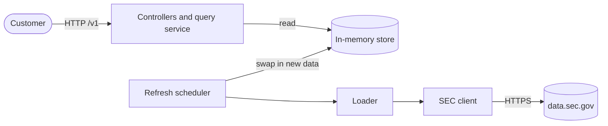

# EDGAR Filings API

A read-only REST API over SEC EDGAR filings for six companies: AAPL, AMZN, GOOGL, GS, META
and NFLX. It serves their 10-K, 10-Q and 8-K filings (and amendments) filed since
2021-01-01, from memory. SEC data is loaded at startup and refreshed every minute in the
background; customer requests never call SEC.

- API contract and design: [docs/specs/2026-11-20-filings-api-core.md](docs/specs/2026-11-20-filings-api-core.md)
- What we found in SEC's data: [docs/research/sec-findings.md](docs/research/sec-findings.md)
- What we built, skipped and would do next: [NOTES.md](NOTES.md)



## Quick start

### 1. Prerequisites

| Tool | Version | Needed for |
|---|---|---|
| Node.js | 26.x LTS, 26.13.1 or later (`node -v`) | everything |
| npm | 11, comes with Node 26 (`npm -v`) | everything |
| Docker | any recent | running the container (optional) |
| Postman CLI | any recent (`postman --version`) | the API test collection (optional) |

You also need internet access to `data.sec.gov`: the service downloads SEC data when it
starts.

### 2. Get the code and install

```sh
git clone <repository-url> edgar-filings-api
cd edgar-filings-api
npm ci
```

`npm ci` may warn that the install script of `@parcel/watcher` was not run. That is
expected and harmless: it is only used by Jest's watch mode.

### 3. Set the one required variable

SEC refuses requests that do not say who is calling. Put your own company name and contact
email in `SEC_USER_AGENT` (the format SEC asks for is `Company Name contact@domain`):

```sh
export SEC_USER_AGENT="Your Company you@your-company.com"
```

Everything else has a default (see [Configuration](#configuration)). The service exits with
code 1 and names the problem if a value is missing or invalid.

### 4. Run locally

```sh
npm run build
npm start
```

It listens on port 3000. If that port is taken, run `PORT=3001 npm start` and use 3001 in
the URLs below. Data is ready in about 8 seconds; check with:

```sh
curl http://localhost:3000/health/ready
```

`"status":"ready"` means you can call the API. Stop it with Ctrl+C.

### 5. Run in Docker

```sh
docker build -t filings-api .
docker run --rm -p 3000:3000 -e SEC_USER_AGENT filings-api
```

`-e SEC_USER_AGENT` passes the value you exported in step 3. If port 3000 is taken, map
another one, e.g. `-p 3001:3000`.

## Use the API

```sh
curl http://localhost:3000/v1/companies/AAPL
curl "http://localhost:3000/v1/companies/AAPL/filings?form=10-K,10-Q&limit=2"
curl http://localhost:3000/v1/filings/0000320193-24-000081
```

| Endpoint | Returns |
|---|---|
| `GET /v1/companies/{ticker}` | The company, and how far back its filings go |
| `GET /v1/companies/{ticker}/filings` | Filings newest first. Optional: `form` (comma-separated), `filedFrom`, `filedTo` (`YYYY-MM-DD`, on `filingDate`), `limit` (1–100, default 20), `cursor` (from `page.nextCursor`) |
| `GET /v1/filings/{accessionNumber}` | One filing, e.g. `0000320193-24-000081` |
| `GET /health/live` | 200 while the process runs |
| `GET /health/ready` | 200 when ready, 503 while loading; per-company status and data age |

Every successful response carries `meta.dataAsOf`, when the data was last refreshed from
SEC. Errors are `application/problem+json`; the error types are listed in spec §8.

## Configuration

All configuration comes from environment variables. `.env` files are not read; set the
variables in your shell or pass them to Docker. [.env.example](.env.example) lists them.

| Variable | Default | Meaning |
|---|---|---|
| `SEC_USER_AGENT` | (required) | Sent to SEC on every request. Must contain a space and an `@` |
| `PORT` | `3000` | HTTP port |
| `REFRESH_INTERVAL_SECONDS` | `60` | Wait between the end of one refresh and the start of the next (at least 10) |
| `FILINGS_SINCE` | `2021-01-01` | Earliest filing date served |
| `SEC_REQUEST_TIMEOUT_MS` | `10000` | Timeout per SEC request (1000–60000) |
| `LOG_LEVEL` | `info` | `debug`, `info`, `warn` or `error` |
| `SEC_BASE_URL` | `https://data.sec.gov/submissions` | Where submissions files are fetched from |
| `SEC_ARCHIVES_BASE_URL` | `https://www.sec.gov/Archives/edgar/data` | Base of `primaryDocumentUrl` |
| `SEC_MAX_REQUESTS_PER_SECOND` | `5` | 1–5; SEC's own limit is 10, counted across all your machines |
| `SEC_MAX_RETRIES` | `2` | Retries (0–5) on timeouts, network errors and 5xx |
| `SEC_RETRY_BASE_DELAY_MS` | `1000` | First retry wait; later waits double |
| `FAILED_COMPANY_RETRY_SECONDS` | `300` | Wait before retrying a company that failed to load |

## Test

```sh
npm run lint
npm run typecheck
npm test
npm run test:e2e
npm audit
```

`npm test` (unit) and `npm run test:e2e` (HTTP, against the real app) use recorded SEC data
in `test/fixtures/` and never call SEC. `npm audit` needs internet access.

### API tests with Postman

The Postman collection checks a running service from the outside, with live SEC data.
Start the service (step 4 or 5), wait until `/health/ready` says `ready`, then:

```sh
postman collection run postman/filings-api.postman_collection.json -e postman/local.environment.json
```

On another port, add `--env-var baseUrl=http://localhost:3001`. Both files can also be
imported into the Postman app.

## Project layout

```
src/
  config/      environment variables, checked at startup
  sec/         SEC client (the only code that calls SEC) and adapter (checks SEC's JSON)
  filings/     loader, merge, store, refresh scheduler, query service, controllers
  health/      liveness and readiness
  common/      injection tokens, logger, problem+json errors
test/          unit and e2e tests, recorded SEC fixtures
postman/       API test collection and environment
docs/          research, spec and plan
```
