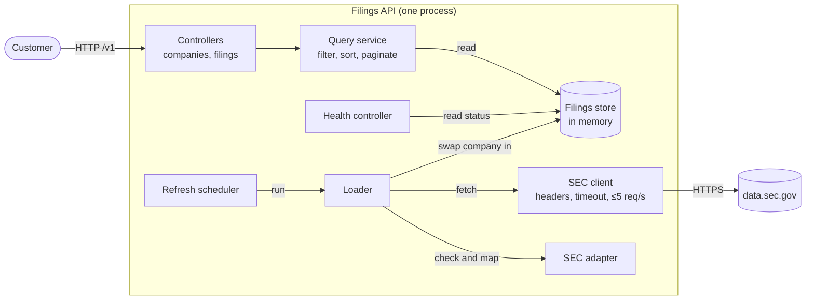
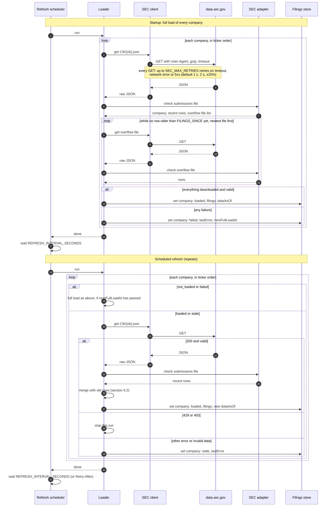
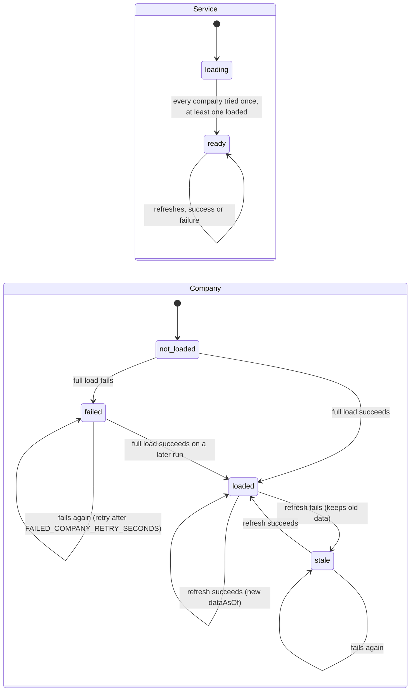

# Spec: EDGAR Filings API — core milestone

- **Status:** draft, awaiting approval. Owner decisions of 2026-11-20 are included:
  readiness rule with retries (§9.3, §9.4) and the 2-hour cut with a Postman test profile
  (§2, §11).
- **Date:** 2026-11-20
- **Evidence:** [docs/research/sec-findings.md](../research/sec-findings.md). Numbers in
  this spec come from there unless stated otherwise.

## 1. Overview

A small read-only REST API over SEC EDGAR for six companies. Customers (quant funds,
research teams) can:

1. look up a company by ticker,
2. list its filings, newest first, filtered by form type and filing date, with pagination,
3. fetch one filing by accession number.

The service downloads SEC data in the background and keeps it in memory. Customer
requests are answered from memory only and **never call SEC**.

## 2. Scope

**Core forms** in this spec means exactly these six: `10-K`, `10-K/A`, `10-Q`, `10-Q/A`,
`8-K`, `8-K/A`.

### In (this milestone)

| Area | What we build |
|---|---|
| Companies | AAPL, META, GOOGL, AMZN, NFLX, GS. Primary tickers only. |
| Forms | Core forms only |
| History | Filings with `filingDate` on or after `FILINGS_SINCE` (default 2021-01-01) |
| Endpoints | The three above, under `/v1`, plus two health endpoints |
| Loading | Load at startup, refresh every `REFRESH_INTERVAL_SECONDS` (default 60) |
| Pagination | Cursor based, stable while data refreshes |
| Errors | RFC 9457 `application/problem+json` for every error |
| SEC safety | Request spacing, retries with backoff for passing failures, stop on 429/403 |
| Operations | Structured JSON logs, liveness and readiness checks, config checked at startup |
| API tests | A Postman collection and environment that exercise every endpoint against a running service (§11.2) |
| Delivery | Tests, lint, type checks, `npm audit` with 0 vulnerabilities, a minimal Dockerfile, README, NOTES.md |

### Out (and why)

| Item | Why it is out |
|---|---|
| API keys, per-client rate limits | Belong at an API gateway. Without keys there is no client identity. Customer requests never reach SEC, so a limit here would only protect our CPU. |
| Other tickers (GOOG, GS-PA, FB, …) | Owner decision (2026-11-20): primary tickers only. They return 404 with the list of supported tickers. |
| Other forms (DEF 14A, S-1, 4, 424B2, …) | Owner decision (2026-11-20): core forms only. The brief's "10-K or 8-K" are examples of a filter, so this is a scope cut, not a reading of the brief. Adding forms later is an addition, not a break. |
| Filtering by `reportDate` | Owner decision (2026-11-20): the date filter uses `filingDate`. `reportDate` is returned so clients can filter on it themselves. |
| Filing contents (XBRL, documents) | Not asked for. We link to the document on sec.gov. |
| Database, shared cache, several instances | The brief says in-memory is fine. See [Scaling](#12-scaling). |

### Next milestone (hardening, not in this spec)

Caching headers (`ETag`, 304, `Cache-Control`), Prometheus metrics and a data-age alert,
token-bucket rate limiter, jittered refresh, generated OpenAPI with a drift test, graceful
shutdown, security headers, Docker healthcheck, multi-stage build and non-root user, CI
pipeline (including the Postman run), measuring event-loop blocking during refresh. Also
the items cut from core below. All of these are additions; none changes the v1 contract.

### Time box (owner decision, 2026-11-20)

The core must fit the brief's 2 hours. Work is ranked; lower ranks give way first.

| Rank | Work | If time runs out |
|---|---|---|
| 1 | Endpoints, filters, cursor, error format, `/v1` | Never cut: this is the contract |
| 1 | SEC client (headers, spacing, retries, stop on 429/403) and adapter checks | Never cut: wrong answers and SEC safety |
| 1 | Load, refresh, merge, readiness | Never cut |
| 1 | Unit tests for the above, config check, lint, types, `npm audit` | Never cut |
| 2 | Postman collection covering every endpoint | Keep one request per endpoint plus one error each |
| 2 | README, NOTES.md, minimal Dockerfile | Keep; trim wording |
| 3 | E2E tests in Jest | One success and one error per endpoint, plus readiness |

Moved to hardening to make room (none of them changes how a correct client behaves):

- the `X-Request-Id` header (logs still get a generated request ID),
- the 18-digit accession form in `/v1/filings/{accessionNumber}` (dashed form only for
  now; accepting more formats later is an addition),
- E2E tests for every error type (the Postman collection and unit tests cover them),
- the Dockerfile beyond a minimal single-stage build.

## 3. Constraints

- TypeScript and NestJS, current Node LTS and current stable libraries. Exact versions are
  fixed at the toolchain check.
- Data in memory, no database.
- Customer requests never call SEC. Only the loader talks to SEC, through one SEC client,
  and all SEC data passes through one adapter that checks it.
- At most 5 SEC requests per second per instance (half of SEC's 10), at least 200 ms apart.
  `SEC_MAX_REQUESTS_PER_SECOND` can lower this but never raise it above 5 (§10).
- No operational value is fixed in code: SEC URLs, request rate, retries and retry delays
  are environment variables with the defaults in §10.
- Every SEC request sends exactly these headers:
  `User-Agent: <SEC_USER_AGENT>`, `Accept-Encoding: gzip, deflate`, `Accept: application/json`.
  `SEC_USER_AGENT` is required and has no default.
- Configuration comes from environment variables only.
- A wrong answer costs customers money. When we are not sure data is complete, we say so
  (an error or `dataAsOf`) instead of returning a partial answer that looks complete.

## 4. What we found in SEC data, and what it means for us

| Finding | What we do about it |
|---|---|
| Filings are parallel arrays; missing values are `""` | The adapter turns rows into objects and turns `""` into `null`. |
| GS has 94,726 filings; 92% are 424B2 | We keep core forms only: 567 rows across all six, GS 146. We still download GS's 2.6 MB `recent` file every refresh. |
| Overflow file date ranges are wrong in 45 of 48 files, by up to 6 days | We do not trust them. We fetch overflow files newest first and stop based on the rows inside (§9.1). |
| `files[]` is newest first, files do not overlap | We rely on the order, and still remove duplicates by accession. |
| `recent` is sorted by `filingDate`, then `acceptanceDateTime` | We use the same order, plus accession number as a final tie-break. |
| `acceptanceDateTime` is real UTC, always with `.000Z`; `filingDate` is an Eastern-time business date | We return both. We normalise the time to `YYYY-MM-DDTHH:mm:ssZ`. The date filter uses `filingDate`. |
| Accession prefix is the submitter, not the company | Lookup by accession uses an index we build, never the prefix. |
| One accession can belong to several companies | Not seen among our six. If it happens, we log a warning (§13). |
| Core forms never have a folder in `primaryDocument` | We still build URLs generically, so a folder would work. |
| No caching headers on `data.sec.gov` | We cannot ask "has it changed?". Every refresh downloads the full file. |
| A rejected User-Agent gets a 403 HTML page | Treated as "stop and alert", not a passing glitch (§9.3). |
| SEC can correct or remove filings later | Filings in the `recent` window are replaced on every refresh. Older ones are not (§13). |

## 5. Architecture

### Options considered

| Option | Verdict |
|---|---|
| 1. Fetch from SEC on each request, with a cache | **Rejected.** Breaks the rule that requests never call SEC. An accession lookup would need all six companies on a cache miss, because the accession prefix is not the company. SEC traffic would follow customer traffic, so SEC's rate limit could not be guaranteed, and a cache expiry under load sends many requests to SEC at once. New queries fail when SEC is down. |
| 2. Load at startup and refresh on a timer, in the service | **Chosen.** No SEC call on the request path, fixed SEC load (6 requests a minute), in-memory speed, last good data kept when SEC is down. Weak points: a restart while SEC is down leaves the service without data, and several instances each poll SEC and may disagree briefly. |
| 3. Separate loader process writing to a shared store | **Not now.** The only option that keeps SEC load fixed whatever the instance count, and survives restarts. Costs a second deployable, a store and a contract between them, which the brief does not need. §12 lists when we would switch. |

### Components



The only path to SEC starts at the scheduler. Nothing on the customer side (controllers,
query service, health) has a reference to the SEC client or the loader.

Components are wired with NestJS dependency injection. Each class receives its
dependencies (config, logger, clock, timers, HTTP client) through its constructor, and
depends on an interface rather than a concrete class where a replacement is plausible:
the loader on `SecSource`, the scheduler and query service on `FilingsStore`. That is what
makes the in-memory store swappable for a shared one (§12) and lets tests replace SEC.

| Component | Job |
|---|---|
| **Controllers** | Parse and check request input, call the query service, shape the response. No business rules. |
| **Query service** | Filtering, ordering, cursor encoding and decoding. Pure functions over a snapshot. |
| **Filings store** | Holds the current state (§6). `get()` returns it; `setCompany()` swaps in a new version of one company. Behind an interface (`FilingsStore`) so a shared store can replace it later. |
| **Loader** | Decides what to fetch, asks the client, passes each raw file to the adapter, merges, and writes to the store. |
| **Refresh scheduler** | Runs the loader at startup and then on a timer. Never runs two loads at once. |
| **SEC client** | The only code that makes HTTP calls to SEC. Takes a file name, returns raw parsed JSON or a typed error (§9.3). Knows nothing about SEC's JSON shape. |
| **SEC adapter** | The only code that knows SEC's JSON shape. Checks a raw file and turns it into our types, or rejects it. |
| **Config** | Reads and checks environment variables once at startup. |

### Suggested layout

```
src/
  config/        env schema and typed config
  sec/           sec-client.ts, sec-adapter.ts, sec.types.ts
  filings/       filings.store.ts, loader.ts, merge.ts, refresh.scheduler.ts,
                 query.service.ts, cursor.ts, companies.controller.ts,
                 filings.controller.ts, dto/
  health/        health.controller.ts
  common/        problem-details filter, logging setup
  companies.ts   the six tickers and their CIKs
test/
  fixtures/      trimmed real SEC responses, recorded 2026-11-20
  unit/ and e2e/
```

## 6. Data model

### Supported companies (fixed in code)

Listed in alphabetical ticker order. "Ticker order" anywhere in this spec means this order.

| Ticker | CIK |
|---|---|
| AAPL | 0000320193 |
| AMZN | 0001018724 |
| GOOGL | 0001652044 |
| GS | 0000886982 |
| META | 0001326801 |
| NFLX | 0001065280 |

CIKs do not change, so we keep this list in code instead of downloading SEC's ticker
file. On each load the adapter checks that the ticker is in the company's SEC `tickers`
list and logs a warning if it is not.

### Company (returned by the API)

| Field | Type | From SEC | Notes |
|---|---|---|---|
| `ticker` | string | our list | Always upper case |
| `cik` | string | `cik` | 10 digits with leading zeros, e.g. `"0000320193"` (SEC already sends it padded) |
| `name` | string | `name` | As SEC writes it, e.g. `"AMAZON COM INC"` |
| `exchange` | string \| null | `exchanges[i]` where `tickers[i]` is our ticker | `null` if SEC does not list our ticker |
| `filingsAvailableFrom` | string (date) | config | `FILINGS_SINCE`: the earliest `filingDate` we hold |

### Filing (returned by the API)

| Field | Type | From SEC | Notes |
|---|---|---|---|
| `accessionNumber` | string | `accessionNumber` | Format `0000320193-24-000081` |
| `ticker` | string | our list | Company the filing was loaded for |
| `cik` | string | company `cik` | 10 digits |
| `form` | string | `form` | One of the core forms |
| `filingDate` | string (date) | `filingDate` | `YYYY-MM-DD`, SEC business date (US Eastern) |
| `reportDate` | string (date) \| null | `reportDate` | Period of report. For 8-K, the event date. `""` becomes `null` |
| `acceptanceDateTime` | string (date-time) | `acceptanceDateTime` | UTC, always `YYYY-MM-DDTHH:mm:ssZ` (SEC's `.000` removed) |
| `primaryDocumentUrl` | string \| null | built from `primaryDocument` | `null` if SEC gives `""` |

`primaryDocumentUrl` =
`{SEC_ARCHIVES_BASE_URL}/{CIK without leading zeros}/{accession without dashes}/{primaryDocument}`
(default base `https://www.sec.gov/Archives/edgar/data`).

We do not return SEC's other columns (`items`, `size`, XBRL flags, …). Adding fields later
is allowed in v1; removing them is not, so we start small.

### Store state

One immutable object, replaced as a whole on every change, so a request that has started
always sees one consistent state:

- per company:
  - `status`: `not_loaded`, `failed`, `loaded` or `stale` (§9.4),
  - `company` and `filings` (core filings since `FILINGS_SINCE`, sorted newest first,
    unique by accession). Empty until the first successful load,
  - `dataAsOf`: when we last downloaded this company's `recent` file successfully (UTC),
  - `lastError`: short text of the last failure, or `null`,
  - `nextFullLoadAt`: for `failed` companies, the earliest time to retry (§9.2),
- one index for the whole store: accession number → filing. If two companies list the same
  accession, the index keeps the first by ticker order and the store logs a warning.

## 7. API contract

General rules:

- Base path `/v1`. Within v1 we only add things (new fields, new optional parameters,
  new error types). Anything that would break a client goes into `/v2`.
- JSON responses, `Content-Type: application/json; charset=utf-8`. Errors use
  `application/problem+json`.
- Tickers are case-insensitive in the path (`aapl` works). Responses use upper case.
- Dates are `YYYY-MM-DD`. Date-times are UTC in the form `YYYY-MM-DDTHH:mm:ssZ`.
- Unknown query parameters, and any query parameter given more than once, are rejected
  with 400, so typos do not silently return unfiltered data.
- Every successful `/v1` response includes `meta.dataAsOf`: when the data behind it was
  last refreshed from SEC.
- When several things are wrong with a request, checks run in this order and the first
  failure is returned: (1) parameter format and rules → 400, (2) unknown ticker → 404,
  (3) data not loaded → 503, (4) filing not found → 404. All parameter problems are
  reported together in one 400.

### 7.1 `GET /v1/companies/{ticker}`

```http
GET /v1/companies/aapl
```

```json
{
  "data": {
    "ticker": "AAPL",
    "cik": "0000320193",
    "name": "Apple Inc.",
    "exchange": "Nasdaq",
    "filingsAvailableFrom": "2021-01-01"
  },
  "meta": { "dataAsOf": "2026-11-20T16:30:00Z" }
}
```

Errors: 404 `company-not-found`, 503 `data-unavailable`.

### 7.2 `GET /v1/companies/{ticker}/filings`

| Parameter | Required | Format | Meaning |
|---|---|---|---|
| `form` | no | comma-separated list, e.g. `10-K,10-K/A` | Exact match on form. `10-K` does **not** include `10-K/A`; ask for both if you want both. Case-insensitive. Empty items (`10-K,`) are rejected. |
| `filedFrom` | no | `YYYY-MM-DD` | `filingDate` on or after this date |
| `filedTo` | no | `YYYY-MM-DD` | `filingDate` on or before this date |
| `limit` | no | integer 1–100, default 20 | Page size |
| `cursor` | no | string from a previous `page.nextCursor` | Continue from that page |

Rules:

- Order is always newest first: `filingDate` descending, then `acceptanceDateTime`
  descending, then `accessionNumber` descending. Accession numbers are unique, so the order
  is total.
- `filedFrom` or `filedTo` earlier than `FILINGS_SINCE` → 400 `date-out-of-range`. We do
  not hold that data, and an empty list would look like "no filings".
- `filedFrom` after `filedTo` → 400 `invalid-parameter`.
- An unsupported form (e.g. `4`) → 400 `invalid-parameter`, listing the supported forms.
- When `cursor` is given, `form`, `filedFrom` and `filedTo` must mean the same as on the
  first request (`limit` may change; form order and case do not matter). Otherwise → 400
  `invalid-cursor`.

```http
GET /v1/companies/AAPL/filings?form=10-K,10-Q&limit=2
```

```json
{
  "data": [
    {
      "accessionNumber": "0000320193-26-000026",
      "ticker": "AAPL",
      "cik": "0000320193",
      "form": "10-K",
      "filingDate": "2026-11-03",
      "reportDate": "2026-09-26",
      "acceptanceDateTime": "2026-11-03T13:05:15Z",
      "primaryDocumentUrl": "https://www.sec.gov/Archives/edgar/data/320193/000032019326000026/aapl-20260926.htm"
    },
    {
      "accessionNumber": "0000320193-26-000020",
      "ticker": "AAPL",
      "cik": "0000320193",
      "form": "10-Q",
      "filingDate": "2026-07-31",
      "reportDate": "2026-06-27",
      "acceptanceDateTime": "2026-07-31T10:01:02Z",
      "primaryDocumentUrl": "https://www.sec.gov/Archives/edgar/data/320193/000032019326000020/aapl-20260627.htm"
    }
  ],
  "page": {
    "limit": 2,
    "nextCursor": "eyJ2IjoxLCJrIjpbIjIwMjYtMDctMzEiLCIyMDI2LTA3LTMxVDEwOjAxOjAyWiIsIjAwMDAzMjAxOTMtMjYtMDAwMDIwIl0sImYiOnsidCI6IkFBUEwiLCJmb3JtcyI6WyIxMC1LIiwiMTAtUSJdLCJmcm9tIjpudWxsLCJ0byI6bnVsbH19"
  },
  "meta": { "dataAsOf": "2026-11-20T16:30:00Z" }
}
```

Both items are real Apple filings, copied from SEC's `CIK0000320193.json` as downloaded on
2026-11-20.

`page.nextCursor` is `null` when there are no more rows. The query service reads
`limit + 1` rows to know this, so a client never gets an extra empty page. An empty `data`
array with `nextCursor: null` means no filings match.

#### How the cursor works

The cursor is opaque to customers. Inside it is base64url-encoded JSON (no padding):

```json
{
  "v": 1,
  "k": ["2026-07-31", "2026-07-31T10:01:02Z", "0000320193-26-000020"],
  "f": { "t": "AAPL", "forms": ["10-K", "10-Q"], "from": null, "to": null }
}
```

- `v` is the cursor format version.
- `k` is the sort key of the last row on the page. The next page is "rows that sort after
  `k`", looked up in the current data.
- `f` holds the filters in canonical form: ticker upper case; forms upper case, without
  duplicates, sorted (`null` when there is no `form` filter); dates or `null`. The request's
  filters are put in the same form and must be equal to `f`.
- Decoding checks every part (version is 1, `k` has a valid date, date-time and accession,
  `f` has the right shape). Any failure → 400 `invalid-cursor`.
- A cursor never expires.

What the cursor guarantees while data refreshes between pages:

- No filing is returned twice.
- Every filing that existed during the whole paging session is returned once.
- New filings normally have the newest dates, so they sort before `k` and do not shift the
  pages; they show up the next time the client starts from the first page.
- A filing that appears during paging with an **older** date than `k` (rare: a late or
  corrected SEC record) is not returned to a client that has already paged past it.
  Clients that sync incrementally should re-read from the first page and stop when they
  reach filings they already have.
- A filing removed during paging simply does not appear.

### 7.3 `GET /v1/filings/{accessionNumber}`

Accepts the dashed form `0000320193-24-000081` only. Anything else is 400
`invalid-parameter`, and the `detail` shows the expected format.

```http
GET /v1/filings/0000320193-24-000081
```

```json
{
  "data": {
    "accessionNumber": "0000320193-24-000081",
    "ticker": "AAPL",
    "cik": "0000320193",
    "form": "10-Q",
    "filingDate": "2024-08-02",
    "reportDate": "2024-06-29",
    "acceptanceDateTime": "2024-08-01T22:03:34Z",
    "primaryDocumentUrl": "https://www.sec.gov/Archives/edgar/data/320193/000032019324000081/aapl-20240629.htm"
  },
  "meta": { "dataAsOf": "2026-11-20T16:30:00Z" }
}
```

`meta.dataAsOf` is the `dataAsOf` of the filing's company.

This example shows the time-zone point: SEC accepted it at 18:03 Eastern on 1 August, after
the 5:30 pm cutoff, so its `filingDate` is 2 August.

Results:

- 200 if the accession is in the index.
- 400 `invalid-parameter` if the format is wrong.
- 503 `data-unavailable` if it is not in the index **and** at least one company has no data
  yet (`not_loaded` or `failed`): we cannot say it does not exist.
- 404 `filing-not-found` otherwise (unknown, not one of our six companies, not a core form,
  or older than `FILINGS_SINCE`). The `detail` says that only core forms filed since
  `FILINGS_SINCE` are available.

### 7.4 Health

Not versioned. They are for our infrastructure, not customers.

| Endpoint | 200 when | 503 when |
|---|---|---|
| `GET /health/live` | the process is running | never |
| `GET /health/ready` | the service is ready (§9.4) | not ready yet |

`/health/live` returns `{ "status": "live" }`. For `/health/ready`, both status codes return
the same body shape (not problem+json: it is read by infrastructure, not customers).
Top-level `status` is `ready` or `loading`;
each company's `status` is `not_loaded`, `failed`, `loaded` or `stale`.

```json
{
  "status": "ready",
  "companies": {
    "AAPL": { "status": "loaded", "dataAsOf": "2026-11-20T16:30:00Z", "lastError": null },
    "GS":   { "status": "stale",  "dataAsOf": "2026-11-20T16:10:00Z", "lastError": "SEC returned 503" }
  }
}
```

(Shortened: the real body lists all six companies.)

## 8. Errors

Every error is `application/problem+json` ([RFC 9457](https://www.rfc-editor.org/rfc/rfc9457)).
`type` is a stable relative URI that clients can match on. `title` is fixed per type.
`detail` explains this case and its wording may change. `instance` is the request path.

```json
{
  "type": "/problems/company-not-found",
  "title": "Company not found",
  "status": 404,
  "detail": "Ticker 'GOOG' is not supported. Supported tickers: AAPL, AMZN, GOOGL, GS, META, NFLX.",
  "instance": "/v1/companies/GOOG"
}
```

Bad input lists each problem:

```json
{
  "type": "/problems/invalid-parameter",
  "title": "Invalid request parameter",
  "status": 400,
  "detail": "One or more query parameters are invalid.",
  "instance": "/v1/companies/AAPL/filings",
  "errors": [
    { "parameter": "form", "detail": "'4' is not supported. Supported forms: 10-K, 10-K/A, 10-Q, 10-Q/A, 8-K, 8-K/A." },
    { "parameter": "limit", "detail": "Must be an integer from 1 to 100." }
  ]
}
```

| Status | `type` | When |
|---|---|---|
| 400 | `/problems/invalid-parameter` | Bad format, unknown or repeated parameter, unsupported form, `filedFrom` after `filedTo` |
| 400 | `/problems/invalid-cursor` | Cursor cannot be decoded or checked, or filters differ from the first request |
| 400 | `/problems/date-out-of-range` | `filedFrom` or `filedTo` earlier than `FILINGS_SINCE` |
| 404 | `/problems/company-not-found` | Ticker not supported |
| 404 | `/problems/filing-not-found` | No filing with that accession number in our data (§7.3) |
| 404 | `/problems/not-found` | Unknown path |
| 503 | `/problems/data-unavailable` | Data needed for the answer has not loaded yet. Sent with `Retry-After: <REFRESH_INTERVAL_SECONDS>` |
| 400 | `/problems/invalid-parameter` | Any other client error the framework detects before our code runs (e.g. a malformed URL), with `errors: []` |
| 500 | `/problems/internal-error` | Bug. Details are logged, never returned |

Fixed `title` per `type`: `invalid-parameter` "Invalid request parameter", `invalid-cursor`
"Invalid cursor", `date-out-of-range` "Date out of range", `company-not-found` "Company not
found", `filing-not-found` "Filing not found", `not-found` "Not found", `data-unavailable`
"Data unavailable", `internal-error` "Internal error". For a bad accession number in the
path, `errors` names the parameter `accessionNumber`.

## 9. How data gets loaded

### 9.1 Full load (startup, and retry of a failed company)

Companies are loaded one at a time, in ticker order. Every SEC request goes through the
client's spacing (≥200 ms apart with the default rate).

1. Client downloads `{SEC_BASE_URL}/CIK{cik}.json` (default `https://data.sec.gov/submissions`).
2. Adapter checks it (§9.3) and returns: the company, the `recent` rows, and the list of
   overflow files.
3. If the oldest `filingDate` in `recent` is before `FILINGS_SINCE`, we have everything.
   Otherwise the loader takes overflow files **in the listed order (newest first)**, one by
   one: client downloads, adapter checks. It stops after the first file whose oldest
   `filingDate` is before `FILINGS_SINCE`, or when the list ends. File dates in the list
   are not used, because they are wrong in 45 of 48 files.
4. If any download or check fails, the company **does not load** and keeps nothing new.
   We never show half a history.
5. Keep rows that are core forms with `filingDate` ≥ `FILINGS_SINCE`. Remove duplicate
   accessions (the `recent` row wins). Sort, set `status: loaded`, `dataAsOf`, and swap the
   company into the store.

Measured cost with `FILINGS_SINCE=2021-01-01`: 31 requests (6 submissions files plus 25
overflow files, 22 of them for GS). At 5 per second, about 7 seconds plus SEC response time.

### 9.2 Scheduled refresh

`REFRESH_INTERVAL_SECONDS` after the previous run **finished** (a chain of timers, not a
fixed interval), the scheduler runs the loader again. For each company in ticker order:

- **`not_loaded` or `failed`:** run the full load (§9.1), but only if `nextFullLoadAt` has
  passed. After a failed full load, `nextFullLoadAt` = now + `FAILED_COMPANY_RETRY_SECONDS`
  (default 300, i.e. 5 minutes) or the refresh interval, whichever is longer. This stops a broken company from re-downloading its overflow files
  every minute (about 26 requests each time for GS).
- **`loaded` or `stale`:** download and check only the `recent` file (1 request), then merge:

  > Let `R` be the oldest `filingDate` in the **new** `recent` file.
  > `new` = core rows from the new `recent` file with `filingDate` ≥ `FILINGS_SINCE`.
  > Result = `new` + every old row with `filingDate` ≤ `R` whose accession is not in `new`.
  >
  > If the new `recent` file has no rows at all, there is no `R` and no evidence that
  > anything was removed: Result = `new` + every old row whose accession is not in `new`.

  So rows dated after `R` come only from SEC's current `recent` file, which means
  removals and corrections there show up. Older rows are kept from our previous data: they
  came from overflow files, or have moved out of `recent` since we loaded them. A row on
  day `R` itself is kept from either side, because SEC may split that day between
  `recent` and an overflow file.

  Worked example (GS, `recent` covers about one year; the filings are made up to show the
  rule):

  | | Before | After refresh |
  |---|---|---|
  | `R` | 2025-11-20 | 2025-11-27 |
  | 8-K filed 2025-11-24 | from `recent` | no longer in `recent`; 2025-11-24 ≤ `R`, kept from old data |
  | 8-K filed 2026-11-19, removed by SEC | from `recent` | not in new `recent`; 2026-11-19 > `R`, dropped |
  | 8-K filed 2026-11-20 (new) | – | in `new`, added |

  Then set `status: loaded`, new `dataAsOf`, and swap the company into the store.
- **If a refresh fails** (download, check), the company keeps its last good data and its
  old `dataAsOf`, `status` becomes `stale` (or stays `failed`), and `lastError` is set.
  Other companies are not affected.
- **If loading a company throws an unexpected error** (a bug, not a SEC or data error), it is
  logged at `error` level, the company keeps its last good data, its `status` becomes
  `stale` (or `failed`) with `lastError: "internal error"`, and the run continues with the
  next company.
- **If SEC answers 429 or 403**, the loader stops the whole run at once: companies not yet
  reached keep their current state. The next run starts after the refresh interval or
  SEC's `Retry-After` header, whichever is longer. A 403 is logged at `error` level as
  "User-Agent rejected, check SEC_USER_AGENT".

Because each run waits for the previous one to finish, runs never overlap. If SEC is slow,
runs just happen less often, and `dataAsOf` shows it.



### 9.3 What the client and adapter check

**SEC client** returns raw parsed JSON or one of these errors: `timeout`
(`SEC_REQUEST_TIMEOUT_MS`), `network`, `rate_limited` (429, with `Retry-After` if sent),
`forbidden` (403), `http_error` (any other non-200), `not_json` (body does not parse). It
builds URLs only from `SEC_BASE_URL` plus `/` and a file name that the adapter
has already checked, or `CIK{10 digits}.json`.

**Retries (owner decision, 2026-11-20).** The client retries a request itself when the
failure is likely to pass:

| Error | Retried? |
|---|---|
| `timeout`, `network`, `http_error` with status 500–599 | Yes, up to `SEC_MAX_RETRIES` more attempts (default 2) |
| `rate_limited` (429) | No. The run stops (§9.2); retrying would make it worse |
| `forbidden` (403) | No. It means our User-Agent is rejected; retrying will not fix it |
| other `http_error` (4xx), `not_json` | No |
| Adapter rejects the data | No. Same data would come back |

- Waits double, starting at `SEC_RETRY_BASE_DELAY_MS` (default 1 second): with the
  defaults, 1 second before attempt 2 and 2 seconds before attempt 3. Each wait is changed
  by a random amount of up to ±25%, so several instances do not retry in step.
- Every attempt goes through the same request spacing, so retries never push us above 5
  requests per second.
- Only after the last attempt fails does the error reach the loader, which marks the
  company `stale` or `failed` (§9.2).
- Worst case with the defaults: a refresh is 18 requests instead of 6, and a startup 93
  instead of 31.

**SEC adapter** rejects the **whole file** (so the load or refresh fails for that company)
if:

- the JSON is not an object, or the columns are missing (`filings.recent` in a submissions
  file, top-level columns in an overflow file),
- the column arrays have different lengths,
- (submissions file only) `cik` is not the 10-digit CIK we asked for,
- (submissions file only) any entry in `filings.files[]` has a `name` not matching
  `^CIK\d{10}-submissions-\d{3}\.json$` with our CIK,
- any accession number appears twice in the file,
- any **core-form row** has:
  - `accessionNumber` not matching `^\d{10}-\d{2}-\d{6}$`,
  - `filingDate` not a real `YYYY-MM-DD` date,
  - `reportDate` not `""` and not a real date,
  - `acceptanceDateTime` not matching `^\d{4}-\d{2}-\d{2}T\d{2}:\d{2}:\d{2}(\.\d{3})?Z$`
    and a real time (the adapter then removes the milliseconds),
  - `primaryDocument` not `""` and not matching `^[A-Za-z0-9._-]+(/[A-Za-z0-9._-]+)*$`,
    or containing `..`.

Rows of other forms are skipped before checking; we do not care if they are odd.

Rejecting the whole file rather than dropping one bad row is deliberate: a silently missing
10-K is a wrong answer. A stale company, with the error in the logs and in
`/health/ready`, is an honest one.

### 9.4 Readiness (owner decision, 2026-11-20)

The service is **ready once every company has been tried once** (each request with its
retries, §9.3) and at least one has loaded. A company that failed returns 503
`data-unavailable` on its own endpoints, and its full load is tried again every
`FAILED_COMPANY_RETRY_SECONDS` (default 5 minutes, §9.2). The other companies are served.

We chose this over "ready only when all six have loaded" because, with whole-file
rejection, one bad GS file would otherwise keep every new instance out of service,
including for AAPL.

Before the first full pass finishes, `/health/ready` returns 503. Once
ready the service stays ready: a company whose refresh fails becomes `stale` and keeps
serving its last good data, with its age in `meta.dataAsOf`. In this milestone there is no
maximum age; hardening adds a data-age alert.



| Company status | Its API requests get | Shown in `/health/ready` |
|---|---|---|
| `not_loaded`, `failed` | 503 `data-unavailable` | yes, with `lastError` |
| `loaded`, `stale` | 200 with its data and `dataAsOf` | yes |

## 10. Configuration (environment variables)

The service checks all of these at startup and exits with a clear message if any is
invalid.

| Variable | Required | Default | Rules |
|---|---|---|---|
| `SEC_USER_AGENT` | **yes** | none | Non-empty, must contain a space and an `@` (SEC's "Company Name email@domain" format) |
| `PORT` | no | `3000` | Integer 1–65535 |
| `REFRESH_INTERVAL_SECONDS` | no | `60` | Integer, at least 10 |
| `FILINGS_SINCE` | no | `2021-01-01` | Real date, `YYYY-MM-DD`, not in the future |
| `SEC_REQUEST_TIMEOUT_MS` | no | `10000` | Integer 1000–60000 |
| `LOG_LEVEL` | no | `info` | `debug`, `info`, `warn` or `error` |
| `SEC_BASE_URL` | no | `https://data.sec.gov/submissions` | `http` or `https` URL; a trailing `/` is removed. Point it at a mock to run without SEC |
| `SEC_ARCHIVES_BASE_URL` | no | `https://www.sec.gov/Archives/edgar/data` | `http` or `https` URL; used to build `primaryDocumentUrl` |
| `SEC_MAX_REQUESTS_PER_SECOND` | no | `5` | Integer 1–5 (never above half of SEC's 10) |
| `SEC_MAX_RETRIES` | no | `2` | Integer 0–5 |
| `SEC_RETRY_BASE_DELAY_MS` | no | `1000` | Integer 100–60000; later waits double |
| `FAILED_COMPANY_RETRY_SECONDS` | no | `300` | Integer, at least 10 |

A `.env.example` file lists them. `.env` files are not loaded automatically; Docker and
the shell pass variables in.

### Logs

One JSON object per line on stdout.

- Each request log has a generated request ID. (Accepting and returning `X-Request-Id`
  is in hardening.)
- Each SEC retry is logged at `warn` with the attempt number and error type.
- The loader logs one line per company per run: ticker, outcome, duration, requests made,
  rows kept, and the error type if it failed.
- At startup we log the config, including `SEC_USER_AGENT`. That value contains a contact
  email on purpose (SEC requires it), and it is not a secret.

## 11. Testing

- **Written first.** Each behaviour gets a failing test before the code.
- **No test calls SEC.** Tests use fixtures: real SEC responses recorded on 2026-11-20 and
  trimmed to a few rows each, stored in `test/fixtures/`. The SEC client is replaced by a
  fake that serves fixtures and fails the test if asked for anything else.

| Level | What is covered |
|---|---|
| Unit: client | Exact request headers; each error type in §9.3, including a 403 HTML body and a non-JSON body; timeout; retry table (retried twice on 503 then succeeds; never retried on 429, 403, 404); retry waits stay inside 1 s / 2 s ±25% (fake timers) |
| Unit: adapter | Parallel arrays to objects; `""` to `null`; milliseconds removed; each rejection rule in §9.3 (including a bad `files[]` name and a duplicate accession); non-core rows skipped; URL building with and without a folder |
| Unit: loader and merge | Overflow stop rule (`recent` already old enough; stop after first older file; list ends); `FILINGS_SINCE` and form filter on load **and** refresh; a failed file means nothing loads; each row of the §9.2 worked example; a row whose `filingDate` changed across `R` is not duplicated |
| Unit: scheduler | Runs never overlap; a failing company becomes stale and the others still refresh; a failed company waits `FAILED_COMPANY_RETRY_SECONDS` (or the interval, if longer) before its next full load; 429/403 stop the run and `Retry-After` is honoured |
| Unit: query and cursor | Sort order with ties; each filter; `filedTo` before `FILINGS_SINCE`; `limit + 1` so the last page has `nextCursor: null`; cursor round trip; same filters in a different order accepted; changed filters and broken cursors rejected; a new filing added between pages causes no duplicate or skip |
| Unit: config | Each rule in §10, including the missing `SEC_USER_AGENT` |
| E2E (Jest, HTTP) | One success and one error per endpoint against the Nest app and the fake SEC client; problem+json content type; readiness before and after the first pass |

"Done" means lint, type checks, tests and `npm audit` (0 vulnerabilities) all pass, and
the Postman run (§11.2) passes against a locally running service.

### 11.2 Postman test profile

A Postman collection that checks the running API from the outside, the way a customer
would. It lives in the repo next to the code:

- `postman/filings-api.postman_collection.json`: the collection, in Postman's v2.1 JSON
  format (importable into the Postman app), with one folder per endpoint (Health,
  Companies, Filings list, Filing by accession),
- `postman/local.environment.json`: a `local` environment with
  `baseUrl = http://localhost:3000`.

Owner decision (2026-11-20): JSON files rather than the v3 YAML layout. Note that
`postman collection lint` checks only v3 collections, so the JSON collection is checked by
running it; `postman environment lint` does check the environment file.

It runs against a real service started with a real `SEC_USER_AGENT`, so it uses live SEC
data. It is not part of `npm test`, which never calls SEC. Run it with the Postman CLI
(checked: version 1.73.0), no login needed for local files:

```sh
postman collection run postman/filings-api.postman_collection.json -e postman/local.environment.json
```

If the service listens on another port, override the base URL:
`--env-var baseUrl=http://localhost:<port>`.

Assertions come from this spec, not from whatever the code returns. They use only facts
that cannot change, such as filing `0000320193-24-000081` from 2024, never "the latest
filing".

| Folder | Requests and checks |
|---|---|
| Health | `/health/live` is 200. `/health/ready` is 200 with `status: ready` and six companies. Runs first: the other folders need a ready service |
| Companies | `AAPL` and `aapl`: 200, CIK `0000320193`, `filingsAvailableFrom` present, `meta.dataAsOf` is a UTC date-time. `GOOG`: 404 `company-not-found` |
| Filings list | Default page: ≤20 rows, newest first by the §7.2 order. `form=10-K`: only 10-K rows. `filedFrom`/`filedTo`: every `filingDate` inside the range. Follow `nextCursor` for 3 pages: no accession repeats, order continues. Errors: `form=4` → 400 `invalid-parameter`; `filedFrom=2019-01-01` → 400 `date-out-of-range`; `filedFrom` after `filedTo` → 400; a broken cursor and a cursor with changed filters → 400 `invalid-cursor`; unknown parameter → 400 |
| Filing by accession | `0000320193-24-000081`: 200 with every field equal to the §7.3 example except `dataAsOf`. Unknown accession → 404 `filing-not-found`. Bad format (`123`) → 400 `invalid-parameter` |
| All error responses | `Content-Type` is `application/problem+json`, body has `type`, `title`, `status`, `detail`, `instance`, and `status` equals the HTTP status |

## 12. Scaling

What one instance costs SEC, with the defaults:

| | Amount |
|---|---|
| Startup | 31 requests (measured), ≤5 per second |
| Each refresh | 6 requests (one `recent` file per company) |
| Download | about 440 MB a day (GS `recent` is 307 KB gzipped, 1,440 times a day) |
| Memory | 567 filings (measured), well under 1 MB |

Running **more than one instance** works, with two catches. Each instance polls SEC on its
own, so SEC traffic grows with the instance count, and many instances starting together
could go over SEC's 10 per second, which counts all our machines together. And instances
refresh at different moments, so two requests can see slightly different data. Cursors
still keep the guarantees in §7.2.

We would move to a separate loader writing to a shared store (Option 3; the store
interface makes this a swap) when any of these becomes true:

1. we need more than one instance for availability or load,
2. losing data on a restart while SEC is down is not acceptable (a cheaper first step:
   save the last state to disk and load it at boot),
3. the company list grows past about 300. SEC's limit allows 600 requests a minute, so
   polling each company every minute stops fitting. We would switch to SEC's nightly bulk
   file plus its latest-filings feed,
4. customers need to reproduce what the API returned at a past time.

## 13. Known limits

| Limit | Effect | Why we accept it now |
|---|---|---|
| Corrections or removals of filings dated on or before `R` (the oldest day in SEC's `recent` file) are not seen until restart | A removed older filing may still be served | Rare. Fixing it means re-downloading overflow files regularly (about 25 more requests per run). |
| A restart while SEC is down leaves the service not ready until SEC returns | Downtime if there is only one instance | Saving the last state to disk is the planned fix (§12). |
| Data age when healthy is up to `REFRESH_INTERVAL_SECONDS`, plus the length of a run, plus SEC's own delay. Stale companies are older, with no upper limit in this milestone | Customers see the age in `meta.dataAsOf` | Matches the refresh decision. Hardening adds an alert. |
| A filing that appears with an older date than a client's cursor is not returned to that client | Incremental sync by paging can miss a late record | Rare. Documented for customers in §7.2. |
| GOOG, FB and other tickers return 404 | Customers must use the primary ticker | Scope decision. Adding aliases later is an addition, not a break. |
| Filings older than `FILINGS_SINCE` return 404 by accession | Looks the same as "does not exist" | The 404 `detail` says how far back we go. |
| If the same accession is ever listed under two of our companies, accession lookup returns the first by ticker order and logs a warning | Lookup shows one company | Not seen in the data. The list endpoint still shows it under both. |
| Each refresh downloads GS's full 2.6 MB file to keep 146 rows | Bandwidth and a short CPU pause every minute | SEC offers no smaller file or "has it changed?" check. Measured in hardening. |
| No API keys or per-client rate limits | Anyone who can reach the service can call it | Belongs at the gateway. |
